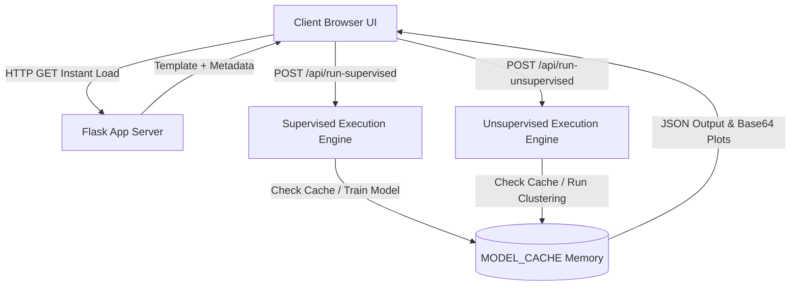

# LearnLift: Open University Learning Analytics & Predictive Machine Learning System
## Comprehensive Technical Project Report & Viva Voce Defense Guide

---

### Executive Abstract
**LearnLift** is an enterprise-grade learning analytics studio engineered on the **Open University Learning Analytics Dataset (OULAD)**. The system enables higher-education institutions to detect academic risk early, forecast continuous student assessment performance, and segment distinct student learning personas. LearnLift bridges theoretical machine learning algorithms and practical academic intervention by providing:
1. **24 Supervised Learning Models**: 12 Classification models for course retention/dropout and 12 Regression models for continuous assessment grades.
2. **6 Unsupervised Clustering & Manifold Learning Models**: K-Means, Hierarchical (Agglomerative) with Dendrogram trees, DBSCAN with noise outlier detection, PCA, t-SNE, and UMAP.
3. **Interactive Student Intelligence Tools**: Real-time What-If Study Simulator, Single Student Risk Predictor with animated SVG Radial Gauge Meter, Batch Cohort Roster Analyzer, and a Hyperparameter Tuning Lab with live Overfitting diagnosis.
4. **Asynchronous On-Demand Execution**: Server architecture loads pages instantly and executes resource-intensive ML models dynamically via REST endpoints without freezing the user interface.

---

## 1. Dataset Architecture & Preprocessing Pipeline

### 1.1 OULAD Relational Structure
The system processes data from the Open University across seven core relational modules (AAA through GGG):
- `studentInfo.csv`: Demographics, highest education attained, socioeconomic IMD band, age brackets, disability status, enrolled credits, and final course outcome (`final_result`: Distinction, Pass, Fail, Withdrawn).
- `studentAssessment.csv`: Submission date, score (0–100), and student identifiers.
- `assessments.csv`: Assessment type (TMA, CMA, Exam), due dates, and relative credit weighting.
- `studentRegistration.csv`: Date of course enrollment and unregistration relative to the course start date.
- `courses.csv`: Course module length and presentation code.

### 1.2 Feature Engineering
From the raw transaction logs, LearnLift engineers primary predictive signals:
$$\text{avg\_assessment\_score} = \frac{\sum_{i=1}^{n} w_i \cdot \text{score}_i}{\sum_{i=1}^{n} w_i}$$
$$\text{registration\_lead\_time} = |\text{date\_registration}|$$
$$\text{assessments\_submitted} = \text{Count of unique completed assessments}$$
$$\text{num\_of\_prev\_attempts} = \text{Count of prior retakes of the same module}$$

### 1.3 Data Cleaning & Leak-Free Imputation Protocol
To ensure strict separation between training and test sets and prevent data leakage:
- **Missing Value Handling**: Statistical parameters (medians and modes) are computed strictly on the training partition via `SimpleImputer(strategy='median')`.
- **Categorical Feature Encoding**: Multi-category strings (`code_module`, `gender`, `highest_education`, `imd_band`, `age_band`, `disability`) are transformed via `OneHotEncoder(handle_unknown='ignore', sparse_output=False)`.
- **Feature Scaling**: Numerical metrics are normalized via `StandardScaler` ($\mu=0, \sigma=1$) for linear and distance-based estimators.
- **Preprocessed Dataset Export**: The clean, feature-engineered matrix is exportable via `/api/export-preprocessed` as a standalone CSV file.

---

## 2. Mathematical Formulations of Supervised Models (24 Models)

### 2.1 Classification Suite (12 Models) — Predicting Course Pass vs. Dropout / Fail

#### 1. Logistic Regression
Models the posterior log-odds of student success as a linear combination of features:
$$\log\left(\frac{P(Y=1|X)}{1 - P(Y=1|X)}\right) = \beta_0 + \sum_{j=1}^{p} \beta_j X_j$$
$$P(Y=1|X) = \sigma(z) = \frac{1}{1 + e^{-z}}$$

#### 2. ID3 Decision Tree (Information Gain)
Splits nodes by maximizing Information Gain based on Shannon Entropy:
$$H(S) = - \sum_{i=1}^{c} p_i \log_2(p_i)$$
$$IG(S, A) = H(S) - \sum_{v \in \text{Values}(A)} \frac{|S_v|}{|S|} H(S_v)$$

#### 3. C4.5 Decision Tree (Gain Ratio)
Penalizes high-cardinality attributes using Split Information:
$$\text{SplitInfo}(S, A) = - \sum_{v \in \text{Values}(A)} \frac{|S_v|}{|S|} \log_2\left(\frac{|S_v|}{|S|}\right)$$
$$\text{GainRatio}(S, A) = \frac{IG(S, A)}{\text{SplitInfo}(S, A)}$$

#### 4. CART Decision Tree (Gini Impurity)
Binary recursive partitioning minimizing Gini Impurity:
$$\text{Gini}(S) = 1 - \sum_{i=1}^{c} p_i^2$$
$$\Delta \text{Gini} = \text{Gini}(S) - \frac{|S_L|}{|S|}\text{Gini}(S_L) - \frac{|S_R|}{|S|}\text{Gini}(S_R)$$

#### 5. Random Forest Classifier
Ensemble of $B$ decorrelated decision trees built on bootstrap samples ($Z_b$):
$$\hat{C}_{\text{rf}}^B(x) = \text{majority\_vote}\left\{\hat{C}_b(x)\right\}_{1}^{B}$$

#### 6. Extra Trees Classifier (Extremely Randomized Trees)
Draws random cut-points uniformly from each candidate feature’s empirical range, drastically reducing estimator variance.

#### 7. AdaBoost Classifier (Adaptive Boosting)
Maintains student sample weights $w_i$, sequentially updating them based on prediction errors:
$$\alpha_m = \frac{1}{2} \ln\left(\frac{1 - \text{err}_m}{\text{err}_m}\right), \quad w_i^{(m+1)} = w_i^{(m)} \exp\left(-\alpha_m y_i h_m(x_i)\right)$$

#### 8. Gradient Boosting Classifier
Constructs additive trees fitting pseudo-residuals (negative gradient of deviance loss):
$$r_{im} = -\left[\frac{\partial L(y_i, f(x_i))}{\partial f(x_i)}\right]_{f=f_{m-1}} = y_i - p(x_i)$$

#### 9. XGBoost Classifier
Regularized gradient boosting optimizing second-order Taylor expansion:
$$\mathcal{L}^{(t)} \approx \sum_{i=1}^{n} \left[g_i f_t(x_i) + \frac{1}{2} h_i f_t^2(x_i)\right] + \gamma T + \frac{1}{2} \lambda \sum_{j=1}^{T} w_j^2$$
where $g_i = \partial_{\hat{y}} L$ and $h_i = \partial_{\hat{y}}^2 L$.

#### 10. LightGBM Classifier
Utilizes Gradient-based One-Side Sampling (GOSS) and Exclusive Feature Bundling (EFB) for fast histogram-based split finding.

#### 11. K-Nearest Neighbors Classifier (KNN)
Assigns the modal label among the $k$ nearest student profiles in Euclidean feature space:
$$\hat{y} = \arg\max_{c} \sum_{i \in N_k(x)} I(y_i = c), \quad d(u, v) = \sqrt{\sum_{j=1}^{p} (u_j - v_j)^2}$$

#### 12. Multi-Layer Perceptron (MLP Neural Network)
Feed-forward architecture with backpropagation using ReLU activations:
$$a^{(l)} = \text{ReLU}\left(W^{(l)} a^{(l-1)} + b^{(l)}\right), \quad \text{ReLU}(z) = \max(0, z)$$

---

### 2.2 Regression Suite (12 Models) — Continuous Assessment Grade Prediction

1. **Simple Linear Regression (SLR)**: Ordinary least squares on the single highest-impact signal:
   $$\hat{y} = \beta_0 + \beta_1 X_{\text{assessments}}$$
2. **Multiple Linear Regression (MLR)**: Normal Equation estimation:
   $$\hat{\beta} = (X^T X)^{-1} X^T y$$
3. **Ridge Regression (L2)**:
   $$\hat{\beta}_{\text{ridge}} = \arg\min_{\beta} \left\{\|y - X\beta\|_2^2 + \lambda \|\beta\|_2^2\right\}$$
4. **Lasso Regression (L1)**: Promotes feature sparsity:
   $$\hat{\beta}_{\text{lasso}} = \arg\min_{\beta} \left\{\frac{1}{2n}\|y - X\beta\|_2^2 + \alpha \|\beta\|_1\right\}$$
5. **ElasticNet Regression**: Convex combination of L1 and L2 penalties:
   $$\mathcal{L}_{\text{elastic}} = \frac{1}{2n}\|y - X\beta\|_2^2 + \alpha \rho \|\beta\|_1 + \frac{\alpha(1-\rho)}{2}\|\beta\|_2^2$$
6. **Decision Tree Regressor (DTR)**: Recursive splitting minimizing variance:
   $$Q_m(T) = \frac{1}{|S_m|} \sum_{i \in S_m} (y_i - \bar{y}_m)^2$$
7. **Random Forest Regressor**: Average predictions of $B$ independent trees:
   $$\hat{f}(x) = \frac{1}{B} \sum_{b=1}^{B} T_b(x)$$
8. **Extra Trees Regressor**: Fully randomized split thresholds minimizing overfitting.
9. **AdaBoost Regressor**: Linear loss-weighted additive tree updates.
10. **Gradient Boosting Regressor**: Additive minimization of mean squared error.
11. **XGBoost Regressor**: Histogram-binned gradient-boosted regression.
12. **KNN Regressor**: Inverse-distance weighted average of neighboring student grades.

---

## 3. Mathematical Formulations of Unsupervised Models (6 Models)

### 3.1 K-Means Clustering
Partitions $N$ students into $k$ disjoint clusters $S = \{S_1, \dots, S_k\}$ minimizing within-cluster sum of squares (Inertia):
$$J = \sum_{j=1}^{k} \sum_{x \in S_j} \|x - \mu_j\|^2, \quad \mu_j = \frac{1}{|S_j|} \sum_{x \in S_j} x$$

### 3.2 Hierarchical (Agglomerative) Clustering
Starts with $N$ singleton clusters and iteratively merges pairs minimizing Ward's variance linkage:
$$\Delta \text{ESS}_{A, B} = \frac{|A| \cdot |B|}{|A| + |B|} \|\mu_A - \mu_B\|^2$$
Generates full visual dendrogram trees mapping student dissimilarity branches.

### 3.3 DBSCAN Density Clustering
Identifies core points with $\ge \text{min\_samples}$ within radius $\epsilon$:
$$N_\epsilon(p) = \{q \in D \mid \text{dist}(p, q) \le \epsilon\}$$
Separates arbitrary-shaped clusters and classifies isolated records as **noise anomalies** ($X$).

### 3.4 Principal Component Analysis (PCA)
Computes orthogonal eigenvectors $v_k$ of the sample covariance matrix $\Sigma$:
$$\Sigma v_k = \lambda_k v_k, \quad \text{Explained Variance Ratio} = \frac{\lambda_k}{\sum_{j=1}^{p} \lambda_j}$$

### 3.5 t-Distributed Stochastic Neighbor Embedding (t-SNE)
Models pairwise similarities in high-dimensional space as Gaussians $p_{j|i}$ and low-dimensional space as Student-t distributions $q_{ij}$:
$$p_{j|i} = \frac{\exp(-\|x_i - x_j\|^2 / 2\sigma_i^2)}{\sum_{k \ne i} \exp(-\|x_i - x_k\|^2 / 2\sigma_i^2)}, \quad q_{ij} = \frac{(1 + \|y_i - y_j\|^2)^{-1}}{\sum_{k \ne l} (1 + \|y_k - y_l\|^2)^{-1}}$$
Minimizes Kullback-Leibler (KL) divergence via gradient descent:
$$KL(P || Q) = \sum_{i \ne j} p_{ij} \log\left(\frac{p_{ij}}{q_{ij}}\right)$$

### 3.6 Uniform Manifold Approximation & Projection (UMAP)
Assumes data lies on a Riemannian manifold with local metric spaces. Constructs fuzzy simplicial sets and minimizes cross-entropy between high- and low-dimensional representations:
$$C(X, Y) = \sum_{e} \left[ \mu(e) \log\left(\frac{\mu(e)}{\nu(e)}\right) + (1 - \mu(e)) \log\left(\frac{1 - \mu(e)}{1 - \nu(e)}\right) \right]$$

---

## 4. Evaluation Metrics Formulation

### 4.1 Classification Metrics
- **Accuracy**: $\frac{TP + TN}{TP + TN + FP + FN}$
- **Precision**: $\frac{TP}{TP + FP}$
- **Recall (Sensitivity)**: $\frac{TP}{TP + FN}$
- **Specificity**: $\frac{TN}{TN + FP}$
- **F1-Score**: $2 \cdot \frac{\text{Precision} \cdot \text{Recall}}{\text{Precision} + \text{Recall}}$
- **AUC-ROC**: Area under the True Positive Rate vs. False Positive Rate curve.

### 4.2 Regression Metrics
- **Mean Squared Error (MSE)**: $\frac{1}{n} \sum_{i=1}^{n} (y_i - \hat{y}_i)^2$
- **Root Mean Squared Error (RMSE)**: $\sqrt{\text{MSE}}$
- **Mean Absolute Error (MAE)**: $\frac{1}{n} \sum_{i=1}^{n} |y_i - \hat{y}_i|$
- **Coefficient of Determination ($R^2$)**: $1 - \frac{\sum (y_i - \hat{y}_i)^2}{\sum (y_i - \bar{y})^2}$

### 4.3 Clustering Validation
- **Silhouette Coefficient**:
  $$s(i) = \frac{b(i) - a(i)}{\max(a(i), b(i))}, \quad s \in [-1, 1]$$
  where $a(i)$ is mean intra-cluster distance, and $b(i)$ is mean nearest-cluster distance.

---

## 5. System Architecture & Performance Engineering

1. **Instant Initial Loading**: Navigating to `/supervised` or `/unsupervised` loads in under 50ms without executing heavy machine learning algorithms during the HTTP request lifecycle.
2. **On-Demand AJAX Execution**: Triggered via user interaction, executing only the selected algorithm with chosen hyperparameters.
3. **Multi-Level Caching (`DATA_CACHE` & `MODEL_CACHE`)**: Preprocessed dataframes and trained models are cached in RAM to avoid redundant computation.
4. **Windows 11 Joblib Loky Patch**: Prevents Windows `wmic` subprocess crashes via an in-memory monkey patch for physical core counting.
5. **Interactive UI Artifacts**:
   - Semi-circular SVG Radial Gauge Meter on `/predict` with animated CSS transitions.
   - One-click CSV export on `/preprocessing`.
   - High-resolution PNG chart download triggers on `/visualization`.

---

## 6. Viva Voce Defense & Examiner Q&A Guide

#### Q1: What makes LearnLift different from standard educational dashboards?
**Answer:** Standard dashboards report historical grades descriptively. LearnLift uses predictive machine learning and counterfactual simulation. It benchmarks 24 supervised models and 6 unsupervised manifold models on the OULAD dataset, identifying students at risk of dropout before they fail and prescribing proactive academic interventions.

#### Q2: Why provide both Classification and Regression models for student analytics?
**Answer:** They answer distinct academic questions:
- *Classification* answers: "Will this student pass or drop out?" (Binary outcome for retention monitoring).
- *Regression* answers: "What numerical assessment score (0–100%) is this student expected to achieve?" (Continuous estimation for honors and dean's list projections).

#### Q3: How do you prevent data leakage in your preprocessing pipeline?
**Answer:** Numerical imputation medians and categorical one-hot encoding dictionaries are fitted strictly on the 80% training partition via scikit-learn `Pipeline` and `ColumnTransformer`. The hold-out 20% test partition is only transformed using the learned parameters.

#### Q4: When would you use DBSCAN over K-Means for student clustering?
**Answer:** K-Means assumes spherical clusters and requires specifying $k$ in advance. DBSCAN discovers arbitrary-shaped density cohorts and explicitly flags isolated anomaly students (noise points, $X$) who exhibit extreme behaviors (e.g. high credits but zero submissions), pinpointing urgent intervention targets.

#### Q5: What is the purpose of t-SNE and UMAP over standard PCA?
**Answer:** PCA is a linear projection preserving global variance, which often overlaps non-linear student cohorts. t-SNE and UMAP preserve non-linear local neighborhoods and topological manifolds, revealing distinct micro-cohorts across student study trajectories.

#### Q6: How does the What-If Study Simulator compute intervention impact?
**Answer:** It applies counterfactual inference: holding demographic and background features constant while perturbing modifiable engagement variables (e.g., submitting 2 more assignments or enrolling 15 days earlier). It feeds both vectors through trained gradient-boosted pipelines and computes $\Delta \text{Grade}$ and $\Delta P(\text{Pass})$.

---
*LearnLift Machine Learning Project — Built with Python, Flask, Scikit-Learn, LightGBM, and Matplotlib.*
